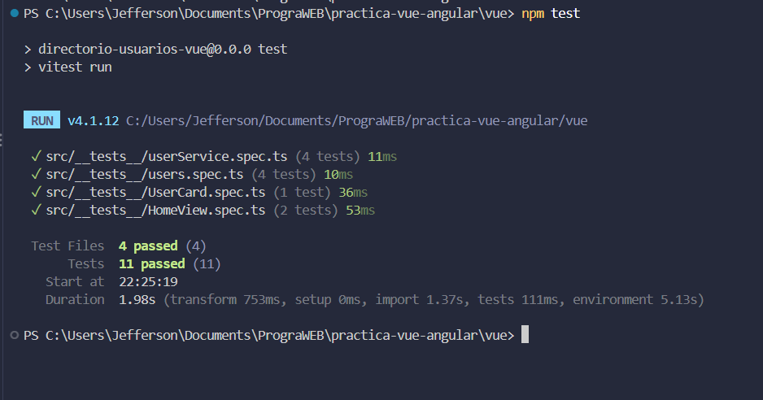
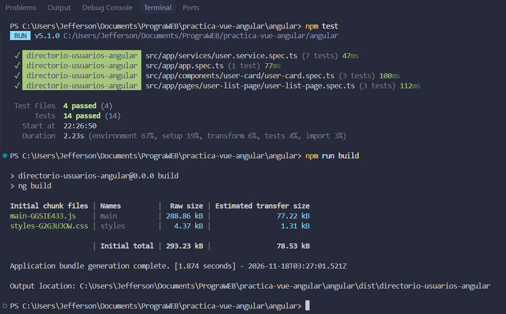
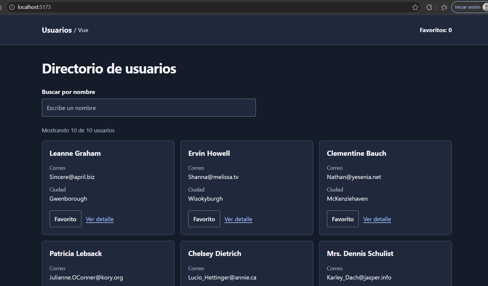
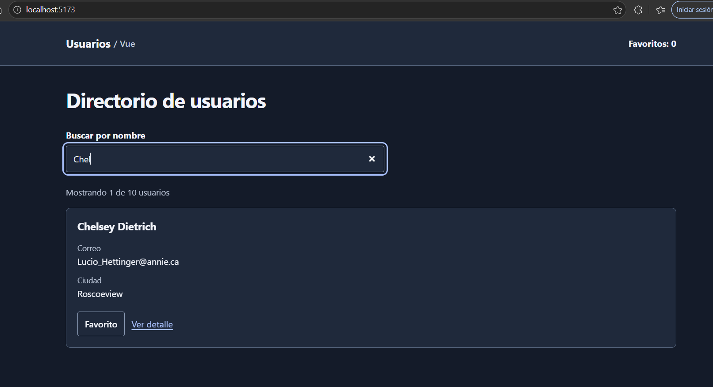
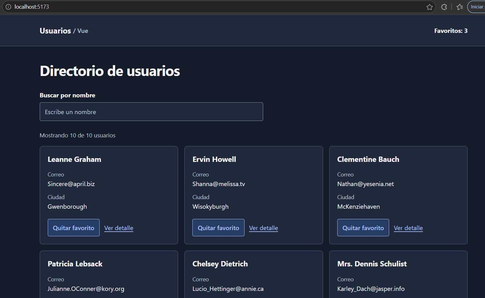
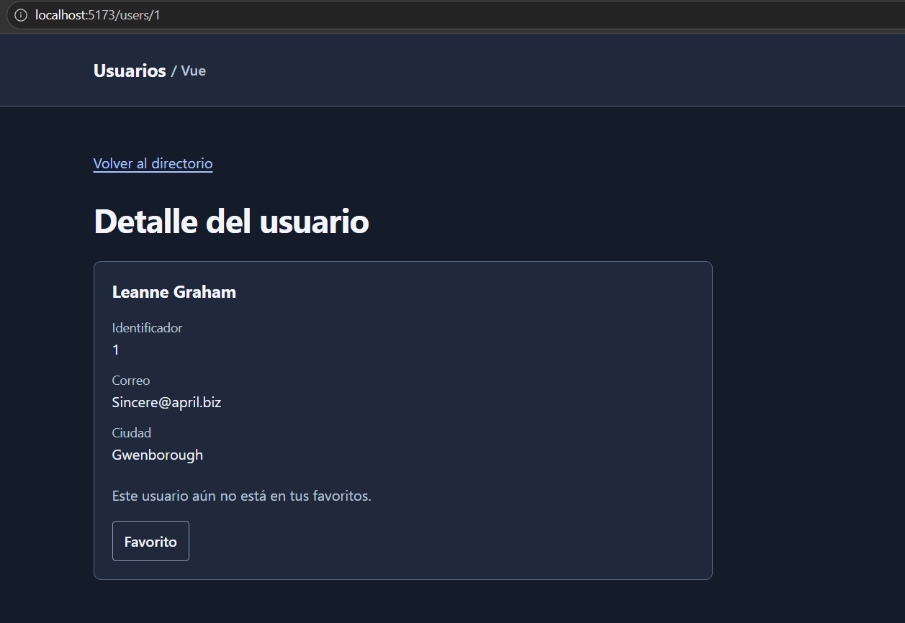
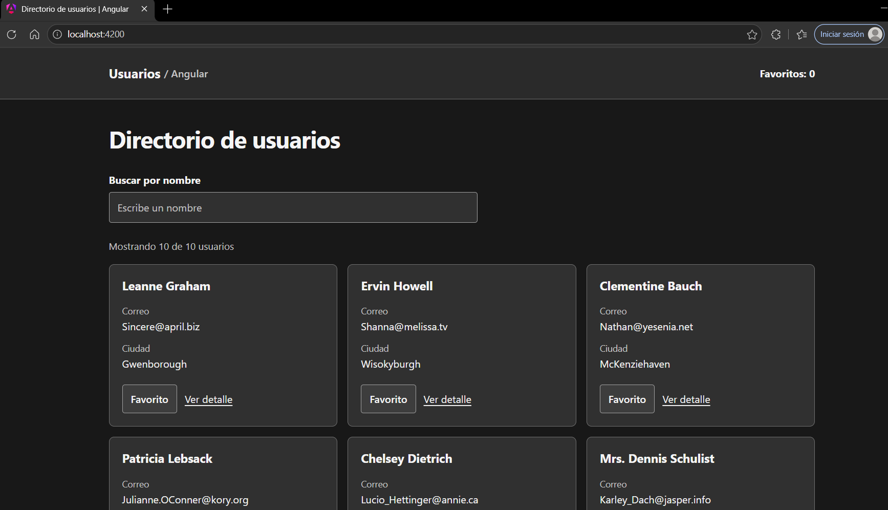
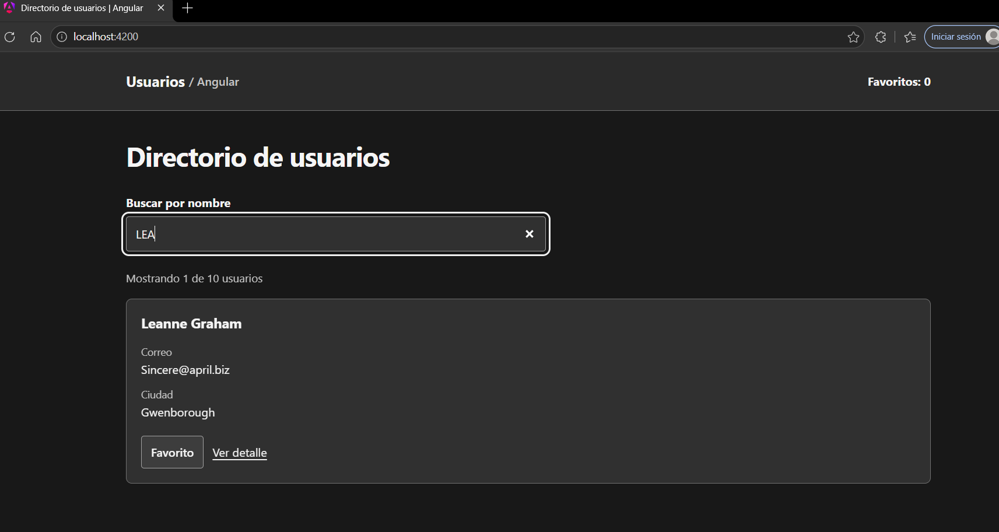
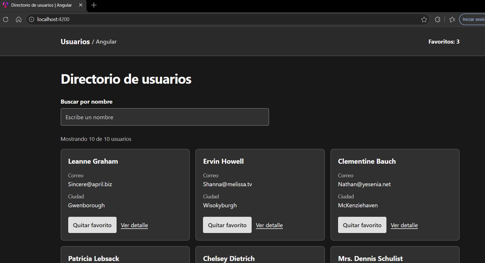
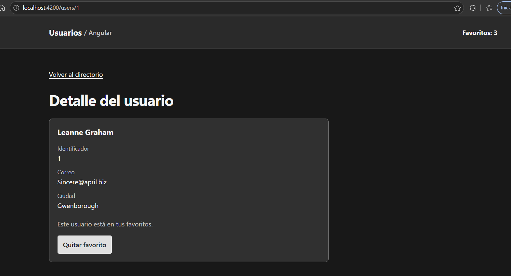

# Práctica de Programación Web: Vue y Angular

En esta práctica se desarrolló una app con Vue y otra con Angular. Ambas consultan la misma API y permiten buscar usuarios por nombre, marcarlos como favoritos y abrir su detalle.

## Ejecutar Vue
En una terminal en la carpeta principal del repositorio ejecutamos:

```powershell
cd vue
npm ci
npm run dev
```

## Ejecutar Angular

En otra terminal en la carpeta principal del repositorio se ejecuta:

```powershell
cd angular
npm ci
npm start
```

## Pruebas y compilación
Se ejecutaron estos comandos para correr las pruebas unitarias y generar la compilación de producción:

```powershell
npm test
npm run build
```
### Vue



### Angular


## Evidencias de funcionamiento

### Vue

El directorio carga los 10 usuarios de la API y muestra sus nombres, correos y ciudades. El contador de favoritos comienza en 0.



Al escribir "Che", el listado se reduce a Chelsey Dietrich y el indicador muestra 1 de 10 usuarios.



Después de marcar tres usuarios como favoritos, el contador muestra 3 y sus botones cambian a "Quitar favorito".



La ruta /users/1 muestra el detalle de Leanne Graham, con su identificador, correo y ciudad.


### Angular

La pantalla inicial de Angular muestra los 10 usuarios y el contador de favoritos en 0.



La búsqueda "LEA" encuentra a Leanne Graham aunque el texto esté escrito en mayúsculas. El indicador muestra 1 de 10 usuarios.



Al seleccionar tres favoritos, el contador cambia a 3.



El detalle de Leanne Graham se abre en /users/1. La captura muestra que el contador conserva los 3 favoritos y que este usuario sigue marcado al cambiar de vista.



